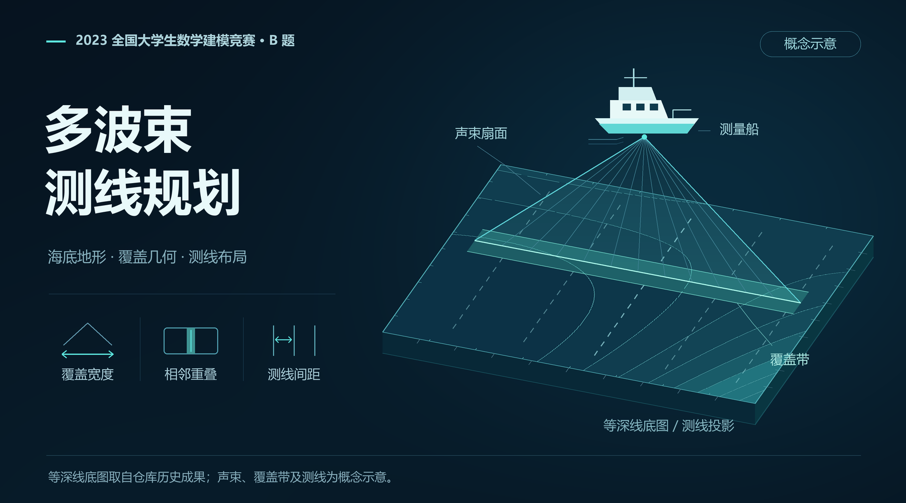

# 2023 数学建模国赛 B 题：多波束测线问题

2023 年全国大学生数学建模竞赛 B 题的三人团队参赛作品，包含论文、历史计算材料，以及可独立验证的平面几何和测线覆盖实现。

**[论文原稿](paper/cumcm2023-b-paper.pdf)** · [几何推导](docs/geometry.md) · [验证记录](docs/optimization-validation.md)



等深线沿用仓库的[历史成果](code/问题四/等深线图.png)；声束、覆盖带与测线为概念示意。参赛时的[测线布设原图](code/问题三/测线布设示意图.png)保留供对照。

## 当前可复现结果

| 问题 | 当前结果 | 证据 |
| --- | --- | --- |
| 一 | 明确垂直水深、水平距离和坡面长度，计算 9 个位置 | [q1.json](outputs/verified-20261015/q1.json) |
| 二 | 原表保留，逐格比较 64 个数值；保留水平投影并修正旧方向坡度公式 | [q2.json](outputs/verified-20261015/q2.json) |
| 三 | **34 条、125936 米**的可行候选，完整覆盖 7408 米宽区域；三种重叠口径均在 10%–20% | [q3.json](outputs/verified-20261015/q3.json) |
| 四 | 完成现有数据来源与硬编码审计，完整求解尚缺原始材料 | [q4-audit.json](outputs/verified-20261015/q4-audit.json) |

第三问只在本次四组可行候选间比较长度，未证明全局最优，总长不含转弯和转场。第四问未将已有处理表冒充可重建的原始数据。

## 运行

Python 3.10 或以上。在仓库根目录执行：

```powershell
python -m pip install -r requirements.txt
python -B -m unittest discover -s tests -v
python -B -m multibeam all --output outputs\my-run
```

输出目录必须尚不存在。命令先完成计算和验证，再写入新的 JSON 报告；不覆盖历史 Excel。也可以选择 `q1`、`q2`、`q3` 或 `q4-audit`：

```powershell
python -B -m multibeam q3 --output outputs\q3-run
python -B tools\record_preserved_files.py --verify
```

原题目路径的 Python 入口委托给同一模块并要求 `--output`。灵敏度入口输出第三问四个重叠率候选的比较。第四问数据处理入口目前输出来源审计，不声称缺失的处理流程已重建。

## 几何与历史结果为何不同

生产求解共用 [geometry.py](multibeam/geometry.py)。它把边缘波束与海底平面直接求交，分别返回水平覆盖宽度和坡面长度。非正水深、非法开角或无法正向交于海底的波束明确失败。[coverage.py](multibeam/coverage.py)独立计算覆盖区间并集、漏测段和相邻重叠。

旧第三问为 32 条、118528 米，按旧公式仍有约 **15.7447 米**边界缺口，论文口径相邻重叠约 **5.9812%**。这些数值被保留为失败反例，不能作为满足约束的短方案。

旧第二问脚本与原表有 48 格不同，最大差约 0.14279 米；去掉投影可追平旧表，但论文把覆盖宽度定义为俯视的水平投影，不能因此直接删除余弦。另有 `tan(α)²` 被写成 `tan(α²)` 的代码错误。按正确水平几何重算后，62 格与旧表不同，推导、方向约定和全部差值均已记录。

## 文件与来源

- `multibeam/`：共享几何、独立覆盖验算、实验和命令行。
- `tests/`：水平海底、反向航行、三维射线求交、非法输入、旧反例和新候选。
- `archive/competition-code/`：竞赛时期 Python/MATLAB 原实现，供历史对照。
- `code/`：活动题目入口及未改动的历史 Excel、图片。
- `paper/`：26 页论文原稿，历史结论需结合更正说明阅读。
- `outputs/verified-20261015/`：本机实际运行的参数、环境与验证报告。

[原件校验清单](docs/preserved-files.json)记录 18 个论文、表格和图片的 SHA-256。第四问缺原始 `附件.xlsx`、第二份处理数据生成规则及可追踪的分区/裁剪流程；MATLAB 尚未复跑。仓库不包含承诺书或队员身份材料。

许可见 [MIT License](LICENSE)。
