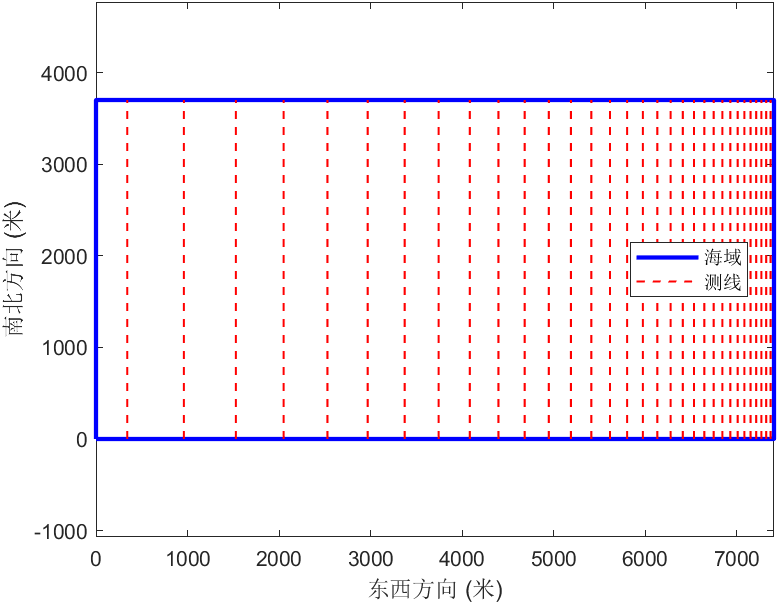

# 2023 年全国大学生数学建模竞赛 B 题：多波束测深系统布局模型

全国大学生数学建模竞赛（CUMCM）2023 年 B 题「多波束测线问题」的参赛论文与求解代码。竞赛期间完成，论文与代码保持提交时的原貌。



## 问题与结果

多波束测深系统一次测量可得到多条测线的水深，需要在给定海域布设测线，实现全覆盖测量并尽量缩短总测量长度。论文围绕覆盖宽度与相邻条带重叠率建立几何模型，逐问求解：

| 问题 | 内容 | 主要结果 |
| --- | --- | --- |
| 一 | 建立覆盖宽度与重叠率模型，计算给定位置的指标 | 见论文表 1，结果文件 `code/问题一/result1.xlsx` |
| 二 | 测线方向与坡面法向不垂直时的覆盖宽度 | 见论文表 2，结果文件 `code/问题二/result2.xlsx` |
| 三 | 设计总长度最短的全覆盖测线方案 | 测线 32 条，最短总长度 118 528 米 |
| 四 | 真实海底地形数据下的分区域测线布设 | 最短测量长度 243 033 米，给出各区域最优测线方向 |

最后做了灵敏度分析（`code/sensitive_analysis.py`）：模型对重叠率较为敏感，结论与适用范围见论文第 6 节。

## 目录

```text
paper/                       论文提交版 PDF（26 页，附录含代码清单）
code/问题一/ … 问题四/        各问求解脚本（Python / MATLAB）、结果文件与示意图
code/sensitive_analysis.py   灵敏度分析
code/灵敏度分析.xlsx          灵敏度分析数据
```

## 运行

- Python 脚本依赖 `openpyxl`、`pandas` 等；各问题脚本相互独立，可单独运行。
- 部分脚本沿用竞赛时的本地绝对路径（如 `D:\桌面\...`），运行前请改为实际路径。
- `code/问题四/` 中的 `.m` 文件需要 MATLAB 运行。

## 说明

- 这是三人团队的参赛作品，论文与代码均为提交版原稿，未做改动。
- 仓库只包含论文与支撑材料中的代码和数据；承诺书等含身份信息的材料不在其中。
- 论文中的数值以竞赛期间的计算为准，未针对后续环境重新运行。

## 许可

论文与代码以 MIT 许可发布，仅供学习与交流。
