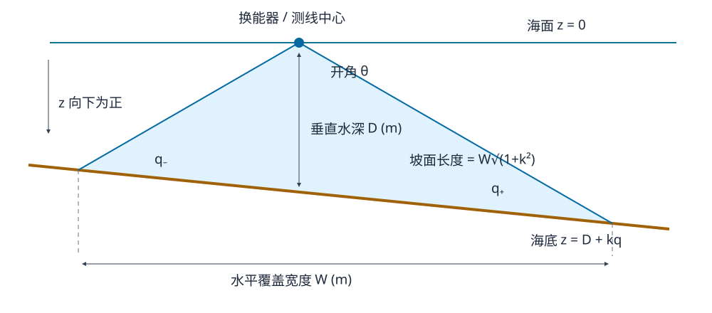

# 坐标与覆盖宽度

本实现计算平面海底上多波束边缘射线的交点。所有平面位置、测线间距和航程均为**水平距离，单位米**；水深是海面到海底的垂直距离。1 海里严格取 1852 米。

## 三维定义

海面为 `z = 0`，z 轴向下为正，海底为：

`z = D0 + gx*x + gy*y`。

测线方向角 β 从 +x 逆时针计算，其单位向量为 `t = (cos β, sin β)`，横测线单位向量为 `n = (-sin β, cos β)`。因此沿线坡度为 `g·t`，横测线坡度为 `k = g·n`。二者都是深度增量除以水平距离，不能直接用 `sin(α)`。

在测量船位置 `(x0, y0)`，垂直水深为 `D = D0 + gx*x0 + gy*y0`。在垂直于测线的波束平面中，以船正下方为横坐标原点，海底化为 `z = D + k*q`。

半开角为 `h = θ/2`。边缘射线的坐标为 `q = ±λ sin h, z = λ cos h`。代入海底方程：

`q− = -D*tan(h)/(1+k*tan(h))`

`q+ = D*tan(h)/(1-k*tan(h))`

所以水平覆盖宽度为 `W = q+ - q−`，坡面覆盖长度为 `W*sqrt(1+k²)`。输入要求 `D > 0`、`0 < θ < 180°` 且 `|k*tan(h)| < 1`。等号对应边缘波束与海底平行；越界则射线正向不与海底相交，程序明确报错。

旧正弦定理写法中的 `D*sin(h)/cos(h±α)` 是坡面半幅长度，乘 `cos(α)` 才得到水平半幅。直接射线求交已经得到水平坐标，不能再重复投影。论文第 5 页与第 8 页公式 (10) 都明确采用水平投影。

## 各题坐标

| 问题 | 平面及角度约定 |
| --- | --- |
| 一 | x 从中心向浅水方向，`D0=70, gx=-tan(1.5°)`；测线与 y 轴平行 |
| 二 | x 取增加水深的方向，`D0=120, gx=tan(1.5°), gy=0`；沿 β 方向航行水平距离 d，船位为 `(d*cos β,d*sin β)` |
| 三 | x 从西边界向东，区域 `[0,7408]`，`gx=-tan(1.5°)`；中心水深 110 米，故西边界水深为 `110+3704*tan(1.5°)`；每条南北测线长 3704 米 |
| 四 | 同一几何函数适用于来源已知的局部平面；当前原始附件和分区处理规则缺失，正式求解入口只出来源审计，不产生未经验证的方案 |

第二问选择 β=0 时向深水航行，与历史表的方向符号一致。若采用相反的法向方向约定，应整体将 β 平移 180°，不能只翻转部分距离的符号。

## 第二问历史差异

原 `Sheet1!C3:J10` 保持不变，64 格逐格记录见 [q2.json](../outputs/verified-20261015/q2.json)。每格同时包含角度、海里/米距离、水平坐标、深度、旧表、旧脚本水平值、旧脚本去投影值、新水平值、新坡面值及差值。

旧脚本与旧表有 48 格不一致，最大绝对差 0.1427899415 米。去掉投影后 64 格与旧表吻合，说明旧表采用了该旧公式的坡面长度。**这不能作为删除水平投影的理由。** 旧代码还把论文中的 `tan(α)²` 写成了 `tan(α²)`；新实现用梯度点积，避免了括号错误和 `tan(90°)` 的奇点。

按本文的水平几何纠正两处问题后，与旧表有 62 格不同，最大绝对差 0.1427902104 米。仅有 β=0°/180°、d=0 的两个格子继续一致。论文和原表作为历史材料保留，其中“覆盖宽度”数值应结合本文更正阅读。

独立特例：水平海底 `W=2D*tan(h)`；β=0°/180° 的横测线坡度为零；β=90°/270° 的航行深度恒为 120 米，水平宽度相同，左右半幅互换。测试还用三维射线与平面直接交点验证所有典型方向。

## 第三问覆盖与重叠

每条测线转换为 `[x-left, x+right]`。验算器按左端点做区间并集，输出目标区间的所有未覆盖部分；它不依赖布线递推，也不会把漏测面积当成零。相邻条带另报告三种归一化口径：

1. 论文第 6 页定义：`η = 1 - 间距/(前条右半幅+后条左半幅)`。
2. 相邻交集长度除以前一条完整水平宽度。
3. 相邻交集长度除以后一区间完整水平宽度。

本次候选同时满足三种口径的 10%–20%，避免在不同分母之间偷换结论。

令单位深度的左、右半幅为 a、b，横向坡度为 g，目标论文重叠率为 ρ。首线取 `x0=a*D0/(1-a*g)`，使左侧恰好覆盖西界；相邻递推步长由重叠等式解得：

`Δx = (1-ρ)*(a+b)*D(x) / (1-(1-ρ)*a*g)`。

保留第一条右端到达东边界的测线。若固定首线和固定重叠率导致测线中心越出区域，候选明确失败；这不是适用于任意区域尺寸的全局优化器。

旧方案使用 `sin(1.5°)` 递减水平位置上的水深、按本条宽度乘 0.9 更新，并在跨越边界前退出。冻结反例得到 32 条、118528 米、15.7447 米缺口，论文口径重叠约 5.9812%。旧方案不参与可行长度排名。

| 论文口径目标重叠 | 测线数 | 总长（米） | 三种口径范围 | 覆盖 |
| --- | ---: | ---: | --- | --- |
| 10.5% | 34 | 125936 | 10.0717%–10.9242% | 完整 |
| 12% | 35 | 129640 | 11.5184%–12.4764% | 完整 |
| 15% | 36 | 133344 | 14.4178%–15.5744% | 完整 |
| 18% | 37 | 137048 | 17.3250%–18.6640% | 完整 |

34 条方案最后条带右界为 7410.3772 米，目标东界为 7408 米。总长仅计各条南北直线的测量距离，不含转弯和转场；未证明全局最优。完整候选和逐对重叠见 [q3.json](../outputs/verified-20261015/q3.json)。
